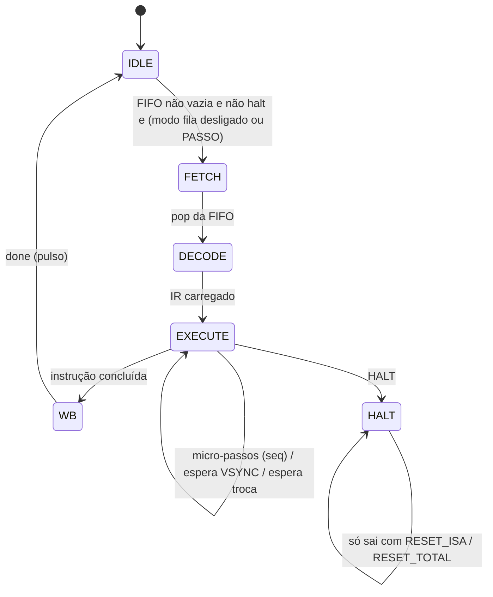

<h1 align="center">
 TEC499-Jogo-na-placa-DE1-SoC-PBL02
</h1>

## Descrição do Projeto

  
Descrição

  O repositório é um dos componentes da segunda fase de um projeto do desenvolvimento de um jogo que irá funcionar na placa **DE1-SoC**. Na primeira fase foi desenvolvido o núcleo de um coprocessador gráfico em FPGA capaz de desenhar background, sprites e polígonos no VGA. Porém, cada motor gráfico ainda precisava ser controlado individualmente, escrevendo diretamente nos seus registradores.

  Nesta segunda fase o núcleo foi transformado em um **coprocessador gráfico programável**: o software não conhece mais os detalhes internos de cada motor, ele apenas envia **instruções de 32 bits** de uma ISA própria. O hardware busca, decodifica e executa essas instruções, acionando os motores gráficos necessários. A arquitetura segue a organização de um processador convencional, com unidade de busca, registrador de instrução (IR), unidade de controle, banco de registradores, ULA, datapath e registradores de estado. As instruções são enviadas pelo processador ARM (HPS) da placa por meio de PIOs mapeados em memória (**busca passiva**).

  O objetivo final deste projeto é criar um coprocessador gráfico completo para suportar a renderização visual de um protótipo do jogo Bomberman, que será controlado por um driver Linux em Assembly ARM e por uma aplicação em C nas etapas futuras.

  Recursos utilizados nesta segunda fase:
  - Placa Terasic DE1-SoC Board com FPGA Cyclone V SoC 5CSEMA5F31C6 (HPS ARM Cortex-A9 dual-core);
  - Quartus Prime 25.1std.0 Lite Edition e Platform Designer (Qsys);
  - ModelSim - Intel FPGA Starter Edition 2020.1 (simulação);
  - Verilog (comportamental).

  
<h2>Requisitos da 2º Etapa</h2>

  - Definir e documentar uma **ISA de 32 bits**, com formatos de instrução e sintaxe própria;
  - Implementar o ciclo de **busca/execução** de instruções;
  - A arquitetura deve ter: unidade de busca, **registrador de instrução (IR)**, **unidade de controle**, **banco de registradores**, **ULA**, **datapath** e **registrador de status**;
  - Toda operação deve ser consequência da execução de uma instrução da ISA;
  - O **compositor**, a **unidade de controle de quadro** e o **controlador VGA** devem operar continuamente;
  - Mecanismo de **sincronização com o VGA**;
  - Comunicação com **valid / busy / done**;
  - Escolha entre busca **ativa** (memória de instruções interna) ou **passiva** (fila de comandos vinda do ARM via MMIO);
  - Pelo menos um programa escrito no **Assembly da ISA**;
  - Testbench para cada módulo principal e um testbench de integração do coprocessador;
  - Relatório de síntese, utilização de recursos, frequência máxima e análise de timing.

<h2>Requisitos funcionais</h2>

### Requisitos funcionais

Requisito | Situação | Onde está
:--- | :---: | :---
ISA de 32 bits documentada (opcode de 6 bits + campos) | Atendido | `control_unit.v`
Unidade de busca (passiva, por fila de comandos) | Atendido | `pio_cmd_iface.v`, `fifo_cmd.v`
Registrador de instrução (IR) | Atendido | `isa_core.v`
Unidade de controle (FSM multiciclo) | Atendido | `control_unit.v`
Banco de registradores de propósito geral (16 × 16 bits) | Atendido | `gpr_bank.v`
ULA | Atendido | `alu.v`
Registrador de status lido pelo ARM | Atendido | `pio_cmd_iface.v` (`pio_status`)
Motores de background, sprites e polígonos como unidades funcionais | Atendido | `motor_background.v`, `motor_sprites.v`, `rasterizador_multi.v`
Unidade de controle de quadro (frame buffer duplo + troca na VSYNC) | Atendido | `frame_buffer_duplo.v`, `coprocessor_core.v`
Compositor e controlador VGA em operação contínua | Atendido | `compositor.v`, `vga_driver.v`
Escrita das memórias de vídeo em tempo de execução (tilemap e padrões) | Atendido | instruções `SET_TILE` e `WR_RAM`
Sincronização com o VGA (`WAIT_VS`, trocas de buffer na VSYNC) | Atendido | `control_unit.v`, `coprocessor_core.v`
Sinais busy / done / estado da fila | Atendido | `pio_status`, LEDs
Modo de execução passo a passo (depuração) | Atendido | comandos `CTRL FILA_ON / PASSO`

<h2>Estrutura proposta e decisões tomadas</h2>

### Visão geral da arquitetura

O top-level (`ghrd_top.v`) instancia o sistema do HPS gerado no Platform Designer e o coprocessador. O HPS se comunica com o coprocessador por três PIOs ligados ao barramento. Dentro do coprocessador, as instruções passam por uma interface de comandos, uma FIFO, o núcleo da ISA (IR, unidade de controle, banco de registradores e ULA) e, por fim, chegam ao banco de registradores gráficos e às memórias de vídeo, que alimentam os motores.

 <figure>
  
  <figcaption>
    

     <b>Figura 1</b> - Diagrama do Coprocessador Gráfico
    

  </figcaption>
 </figure>

### Busca passiva

Foi escolhida a **busca passiva**: em vez de uma memória de instruções interna, o coprocessador recebe as instruções do ARM por uma fila de comandos. Essa decisão foi tomada porque:
- o jogo final será executado no ARM, então é ele quem decide o que desenhar a cada quadro (posição do jogador, inimigos, explosões). O programa fixo em `.mif` não conseguiria fazer isso;
- prepara diretamente o caminho para o driver Linux em Assembly ARM das próximas etapas;
- permite trocar o programa de teste sem recompilar a FPGA.

A consequência é que o controle de fluxo (laços e desvios) fica no programa do ARM.

### Domínios de clock e sincronização

Foram mantidos os dois PLLs da primeira etapa, gerados a partir do `CLOCK_50`:
-  clock de pixel de 25 MHz (`clk_pix`) para 640 × 480 a 60 Hz;
- clock de sistema de 100 MHz (`clk_sys`), usado pela interface de comandos, pela ISA, pelo banco de registradores gráficos e pelas RAMs de vídeo.

O reset global combina o `hps_fpga_reset_n` com os sinais `locked` dos dois PLLs. Os cruzamentos entre os domínios são assim:
- **VSYNC → clk_sys:** sincronizador de 3 flip-flops com detecção de borda, usado pela instrução `WAIT_VS` e pelo bit de status;
- **Pedidos de troca (clk_sys → clk_pix):** cada pedido inverte um *toggle*, que atravessa 3 flip-flops e é convertido de volta em pulso no domínio de pixel;
- **Atributos gráficos (clk_sys → clk_pix):** todos os atributos de sprites, polígonos, camadas e scroll são concatenados em um único vetor, registrados uma vez no domínio de pixel (`attr_meta`) e só copiados para os registradores usados pelos motores na borda da VSYNC. Assim, uma cena nunca é desenhada com metade dos atributos antigos e metade novos;
- **Buffer visível (clk_pix → clk_sys):** `bg_frente` e `fb_frente` passam por 2 flip-flops e são usados pela unidade de controle para saber quando uma troca terminou.

### Interface de comandos (pio_cmd_iface)

O ARM escreve a palavra de 32 bits em `pio_cmd_data` e gera uma borda de subida em `pio_cmd_push` (escreve 1 e depois 0). A interface detecta essa borda e:
- se o opcode for `62` (**CTRL**), executa um comando de controle sem passar pela FIFO;
- caso contrário, coloca a palavra na FIFO (se ela estiver cheia, a palavra é descartada, por isso o software deve consultar o status antes de enviar).

Comandos de controle (`CTRL`, campo `ir[9:6]`):

Código | Comando | Função
:---: | :--- | :---
1 | `FILA_ON` | Ativa o modo fila: a FIFO apenas acumula instruções
2 | `FILA_OFF` | Desativa o modo fila: a FIFO volta a ser esvaziada em sequência
3 | `PASSO` | Executa uma única instrução da fila (com o modo fila ativo)
4 | `RESET_ISA` | Reinicia apenas o núcleo da ISA (FIFO, IR, GPRs e FSM)
5 | `RESET_TOTAL` | Reinicia a ISA e os registradores gráficos
6 | `VER_QTD` | `pio_status` passa a mostrar a quantidade de instruções na FIFO
7 | `VER_STATUS` | `pio_status` volta ao formato normal

O modo fila e o passo a passo foram criados para depuração: é possível carregar várias instruções e executá-las uma a uma, observando o efeito de cada uma na tela e nos LEDs.

### Núcleo da ISA (isa_core)

O `isa_core` agrupa a FIFO, o registrador de instrução, o banco de registradores, a ULA e a unidade de controle. A FIFO possui saída registrada, então o IR é carregado no ciclo seguinte ao `pop`. O banco de registradores possui 16 registradores de 16 bits, com `R0` fixo em zero, duas portas de leitura (`Rs` e `Rt`) e uma de escrita (`Rd`). A ULA de 16 bits realiza `ADD`, `SUB`, `AND`, `OR` e `MOV`.

Os registradores de propósito geral permitem que o movimento seja feito por **deslocamento relativo**: o programa guarda a velocidade em um registrador (por exemplo `R1 = 2`) e as instruções `MOV_BG`, `SPR_MOV` e `PLY_MOV` somam o valor dos registradores à posição atual do objeto.

### Unidade de controle

A unidade de controle é uma máquina de estados multiciclo:

- **IDLE:** aguarda instrução na FIFO;
- **FETCH:** retira a instrução da FIFO (`fifo_pop`);
- **DECODE:** o IR é carregado e o contador de micro-passos é zerado;
- **EXECUTE:** gera os sinais para o banco gráfico, memórias de vídeo, GPRs e ULA. Instruções que precisam escrever vários registradores gráficos (por exemplo `SPR_POS`, que seleciona o sprite e escreve X e Y) usam um contador interno `seq`, gastando um ciclo por escrita;
- **WB:** fim da instrução, gera o pulso `done`;
- **HALT:** trava o núcleo até um reset por software.

Instruções de sincronização ficam em EXECUTE até a condição ser atendida:
- `WAIT_VS` espera a próxima borda de VSYNC;
- `SWAP_FB` e `SWAP_BG` só terminam quando o buffer visível realmente trocou. Isso garante que as instruções seguintes nunca alterem o quadro que está prestes a ser apresentado.

### Unidade de controle de quadro (frame buffer duplo)

Diferente da primeira etapa, onde os motores enviavam a cor diretamente ao VGA, nesta etapa foi adicionado um **frame buffer duplo** de 2 × 320 × 240 bytes. O compositor escreve continuamente o quadro no buffer escondido (*back*), enquanto o VGA lê o buffer visível (*front*). O fluxo de uma troca é:

1. `SWAP_FB` pede a troca (`swap_fb_request`);
2. na próxima VSYNC os atributos novos são copiados e a troca fica "armada";
3. durante esse quadro a cena nova é composta inteira no buffer escondido;
4. na VSYNC seguinte os buffers são trocados e a instrução termina.

Essa decisão foi tomada para que uma cena nunca seja exibida pela metade, mesmo que o ARM demore para enviar todas as instruções de um quadro.

### Memórias de vídeo

As memórias continuam sendo blocos RAM dual-port gerados pelo Quartus (`altsyncram`), inicializados por arquivos `.mif`, mas agora possuem **porta de escrita ligada à ISA**:
- Duas RAMs de tilemap (A e B) de 2048 × 8 bits (`tilemap_a.mif`, `tilemap_b.mif`), com troca na VSYNC por `SWAP_BG`;
- RAM de padrões de tiles com 16384 × 8 bits (256 tiles de 8 × 8) (`padroes_tiles.mif`);
- RAM de padrões de sprites com 8192 × 8 bits (32 padrões de 16 × 16) (`padroes_sprites.mif`).

A instrução `SET_TILE` escreve uma posição do tilemap no buffer escondido, no visível ou em ambos, e `WR_RAM` escreve um byte qualquer em uma das quatro memórias. Com isso, a limitação da primeira etapa (memórias fixas, sem escrita em tempo de execução) foi resolvida.

### Motores gráficos

Os motores do Problema 1 foram reaproveitados como unidades funcionais, com pequenas alterações:
- **Motor de background:** pipeline de 3 estágios, tilemap 40 × 30, tiles 8 × 8 e scroll com *wrapping* por subtrações condicionais de 320/240;
- **Motor de sprites:** 32 sprites de 16 × 16 avaliados em paralelo, com espelhamento horizontal e vertical. A escolha entre sprites no mesmo pixel é feita por uma **árvore de comparação** de prioridade (em caso de empate vence o sprite de maior índice). O índice de cor `0` é transparente;
- **Rasterizador:** 4 slots de polígonos, com 6 formas (retângulo, quadrado, triângulo retângulo, isósceles com ápice para cima ou para baixo e escaleno), definidas por origem (X, Y) e tamanho. A geometria de cada slot é pré-calculada uma vez por ciclo e o teste de inclusão usa funções de aresta com aritmética inteira, em um pipeline de 3 estágios.

### Compositor e regra de prioridade

O compositor combina as três camadas com transparência pelo índice `0`. A prioridade entre sprites e polígonos agora é **configurável** pela instrução `SET_PRI`:
- `SET_PRI 1` (padrão): sprite > polígono > background;
- `SET_PRI 0`: polígono > sprite > background.

### Saída VGA

O `vga_driver` é usado apenas como gerador de timing (HSYNC, VSYNC e coordenadas). A cor é lida do frame buffer e convertida de RGB332 para os 8 bits por canal do DAC. Cor, HSYNC, VSYNC e BLANK são registrados juntos, com o mesmo atraso, e o `VGA_CLK` é o clock de pixel invertido, colocando a borda de amostragem do DAC no meio do pixel.

### Justificativa das principais decisões

As decisões centrais foram orientadas por três critérios:
- desacoplar o software dos detalhes internos de cada motor, deixando a ISA como única interface;
- manter a saída de vídeo estável e sem tearing, independentemente do ritmo do software;
- preparar a arquitetura para o driver em Assembly ARM e para o jogo em C das próximas etapas.

A busca passiva por PIO, a FIFO de comandos, as cópias de atributos na VSYNC, o frame buffer duplo e as instruções de troca que só terminam após a troca efetiva refletem esse equilíbrio entre simplicidade de hardware, previsibilidade para o software e estabilidade do vídeo.

 
<h2>Análise de Recursos</h2>

 Esta seção consolida os resultados de síntese e análise de timing obtidos com o Quartus Prime 25.1std.0 Lite para o dispositivo Cyclone V 5CSEMA5F31C6 (DE1-SoC). Os números são do projeto completo (top-level <code>ghrd_top</code>), incluindo o sistema do HPS.

### Utilização de recursos

Recurso | Projeto completo | Disponível | Uso
:--- | ---: | ---: | :---:
ALMs | 5.324 | 32.070 | 17 %
Registradores | 8.622 | — | —
Bits de memória em bloco | 1.985.569 | 4.065.280 | 49 %
Blocos M10K | 250 | 397 | 63 %
Blocos DSP | 12 | 87 | 14 %
PLLs | 2 | 6 | 33 %
Pinos | 382 | 457 | 84 %

Distribuição dentro do coprocessador (`coprocessor_core`):

Módulo | ALMs | Registradores | Bits de memória | M10K | DSP
:--- | ---: | ---: | ---: | ---: | ---:
**coprocessor_core (total)** | **2.845** | **4.896** | **1.459.233** | **182** | **12**
rasterizador_multi | 882 | 620 | 0 | 0 | 12
banco_registradores | 666 | 1.170 | 0 | 0 | 0
motor_sprites | 487 | 327 | 0 | 0 | 0
isa_core (FIFO + IR + GPR + ULA + UC) | 313 | 321 | 1.024 | 1 | 0
frame_buffer_duplo | 62 | 12 | 1.228.800 | 152 | 0
vga_driver | 38 | 41 | 0 | 0 | 0
motor_background | 26 | 40 | 0 | 0 | 0
pio_cmd_iface | 15 | 42 | 0 | 0 | 0
compositor | 5 | 0 | 0 | 0 | 0
RAMs de vídeo (tilemaps + padrões) | 4 | 2 | 229.376 | 28 | 0

O restante (cerca de 2.326 ALMs e 68 M10K) pertence ao sistema do HPS gerado no Platform Designer (interfaces, JTAG UART e memória on-chip de 64 KB).

O item que mais cresceu em relação à primeira etapa foi a memória: o **frame buffer duplo sozinho ocupa 1,2 Mbit e 152 blocos M10K** (38 % dos blocos da FPGA). A lógica da ISA em si é pequena (cerca de 313 ALMs), mostrando que transformar o núcleo em um coprocessador programável custou pouco em lógica. O banco de registradores gráficos continua grande porque guarda os atributos de 32 sprites e 4 polígonos em registradores, que são lidos todos ao mesmo tempo pelos motores.

### Timing e frequências

Fmax reportado no modelo Slow 1100 mV 85 °C:

Domínio | Frequência alvo | Fmax | Slack de setup | Slack de hold
:--- | :---: | :---: | :---: | :---:
`clk_sys` (pllpara100) | 100 MHz | 118,2 MHz | +1,524 ns | +0,245 ns
`clk_pix` (meu_pll) | 25 MHz | 47,49 MHz | +2,811 ns | +0,287 ns
`CLOCK_50` | 50 MHz | 94,47 MHz | +3,114 ns | +0,272 ns
`altera_reserved_tck` (JTAG) | — | 65,34 MHz | +9,306 ns | +0,361 ns

Todos os domínios do coprocessador fecham com folga. O domínio de 100 MHz, onde roda a ISA, é o mais apertado (cerca de 18 % de margem). Os caminhos com slack negativo que aparecem no relatório (`soc_system.sta.rpt`) pertencem à interface DDR3 do HPS (`hps_sdram`, IP UniPHY), e não ao coprocessador.

### Desempenho funcional

- **Execução de instruções:** cada instrução passa por IDLE → FETCH → DECODE → EXECUTE → WB, levando cerca de **5 ciclos de `clk_sys` (50 ns)** para instruções simples e até 8 ciclos (80 ns) para as que fazem várias escritas, como `PLY_DRAW`. Isso permite executar mais de 10 milhões de instruções por segundo;
- **Envio pelo ARM:** cada instrução exige 3 escritas MMIO (dado, push = 1, push = 0), então o gargalo real é o barramento HPS → FPGA, e não o coprocessador;
- **Taxa de quadros:** o VGA é gerado a 60 Hz. Como `SWAP_FB` só termina após o quadro novo ter sido composto inteiro, um laço que chama `SWAP_FB` a cada quadro atualiza a cena a cada 2 quadros VGA (**cerca de 30 quadros por segundo**);
- **Latências de sincronização:** `WAIT_VS` dura até 1 quadro (16,7 ms); `SWAP_BG` até 1 quadro; `SWAP_FB` entre 1 e 2 quadros.

### Gargalos identificados

Os principais gargalos observados na arquitetura atual são:
- **Envio instrução a instrução pelo PIO:** três acessos MMIO por instrução e a necessidade de consultar o status para não perder palavras quando a FIFO enche;
- **Frame buffer duplo:** consome a maior parte da memória em bloco da FPGA, limitando a adição de novos recursos que usem RAM;
- **Avaliação paralela de 32 sprites e 4 polígonos:** a árvore de prioridade dos sprites e os multiplicadores do rasterizador são os maiores blocos de lógica no domínio de pixel;
- **Taxa efetiva de 30 quadros por segundo** quando todos os quadros usam `SWAP_FB`.

### Limitações conhecidas

- `JMP` e `BEQ` estão reservados na ISA, mas são executados como NOP, pois na busca passiva o fluxo é controlado pelo ARM;
- A paleta programável de 256 cores do Problema 1 não é mais usada: as cores são lidas diretamente em RGB332 (o arquivo `paleta.mif` permanece no projeto, mas não está ligado);
- O scroll absoluto (`SET_BG_X` / `SET_BG_Y`) possui 8 bits (0 a 255), menor que a largura de 320 pixels;
- Em `PLY_DRAW` a coordenada X tem 9 bits e é estendida com sinal, então valores X ≥ 256 são interpretados como negativos e o polígono aparece no lugar errado perto da borda direita (o movimento relativo com `PLY_MOV` não tem esse problema);
- `SPR_CFG` só permite prioridades de 0 a 3, embora o registrador interno tenha 3 bits;
- Se a FIFO estiver cheia, a palavra enviada é descartada silenciosamente; o software deve verificar o bit `fifo_full` antes de enviar;
- O sinal de endereço inválido do banco de registradores gráficos não chega ao `pio_status`;
- Apenas 4 polígonos simultâneos.

### Melhorias possíveis

Com base na análise de recursos e timing, as melhorias mais promissoras são:
- Substituir os PIOs por uma interface Avalon-MM com escrita direta na FIFO (uma escrita por instrução) ou por DMA, removendo o gargalo do envio;
- Implementar `JMP`/`BEQ` com uma memória de instruções interna, permitindo que pequenos programas rodem sem o ARM (busca ativa);
- Reintroduzir a paleta programável e sub-paletas por sprite;
- Reduzir o frame buffer (por exemplo, compondo linha a linha com *line buffers*), liberando memória para mais padrões e uma segunda camada de background;
- Ampliar o scroll para 9 bits e corrigir a extensão de sinal da coordenada X de `PLY_DRAW`;
- Gerar uma interrupção para o ARM no fim de cada quadro, evitando que o software fique consultando o status.

### Conclusão da análise

O coprocessador utiliza uma fração modesta da lógica da Cyclone V e fecha timing em todos os seus domínios. O custo de tornar o núcleo programável (FIFO, IR, unidade de controle, GPRs e ULA) foi pequeno, enquanto o maior consumo vem do frame buffer duplo, que foi a escolha feita para garantir quadros completos e sem tearing. Os pontos de atenção se concentram na interface de envio de instruções e no uso de memória.

## Estrutura Implementada

Módulos do Sistema

Os arquivos RTL ficam na pasta `rtl/` e o top-level da placa é `ghrd_top.v`.

Arquivo | Função
:--- | :---
`ghrd_top.v` | Top-level da DE1-SoC: instancia o `soc_system` (HPS + PIOs) e o coprocessador
`coprocessor_core.v` | Top-level do coprocessador: PLLs, sincronizações, ISA, banco gráfico, memórias, motores, frame buffer e VGA
`pio_cmd_iface.v` | Interface com os PIOs: detecção de push, comandos CTRL e registrador de status
`fifo_cmd.v` | Fila de instruções de 32 posições × 32 bits
`isa_core.v` | Núcleo da ISA: FIFO, IR, GPRs, ULA e unidade de controle
`control_unit.v` | Unidade de controle (FSM) e decodificação das instruções
`gpr_bank.v` | Banco de 16 registradores de 16 bits (R0 = 0)
`alu.v` | ULA de 16 bits
`banco_registradores.v` | Registradores gráficos (scroll, sprites, polígonos, camadas, trocas)
`motor_background.v` | Motor de background (tilemap)
`motor_sprites.v` | Motor de sprites
`rasterizador_multi.v` | Rasterizador de polígonos
`compositor.v` | Composição das camadas com prioridade configurável
`frame_buffer_duplo.v` | Frame buffer duplo 320 × 240 (unidade de controle de quadro)
`vga_driver.v` | Timing VGA 640 × 480
`ram_*.v`, `*.mif` | RAMs de vídeo (IP altsyncram) e seus conteúdos iniciais
`meu_pll*.v`, `pllpara100*.v` | PLLs de 25 MHz e 100 MHz

### Registrador de Instrução e Unidade de Controle

Busca, decodificação e execução

A instrução retirada da FIFO é guardada no IR, de onde saem o opcode (`ir[5:0]`), os índices de registradores e os campos imediatos. A unidade de controle decodifica o opcode e, em EXECUTE, gera os sinais para o datapath: escrita nos GPRs, operação da ULA, escrita no banco de registradores gráficos (`gfx_wr_en`, `gfx_addr`, `gfx_data`) e escrita nas memórias de vídeo (`mem_we`, `mem_addr`, `mem_data`).

### Banco de Registradores e ULA

Datapath de propósito geral

O banco possui 16 registradores de 16 bits com leitura combinacional em duas portas (`Rs = ir[13:10]`, `Rt = ir[17:14]`) e escrita síncrona (`Rd = ir[9:6]`). `R0` sempre retorna zero, o que permite usar `R0` como "sem deslocamento" nas instruções de movimento. A ULA recebe `Rs` e `Rt` e devolve o resultado para `Rd`. No caso do `MOVI`, o valor escrito vem do campo imediato da instrução.

