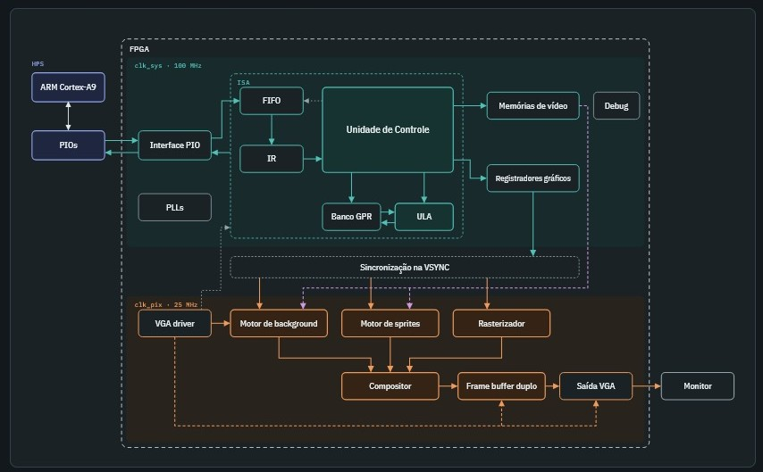
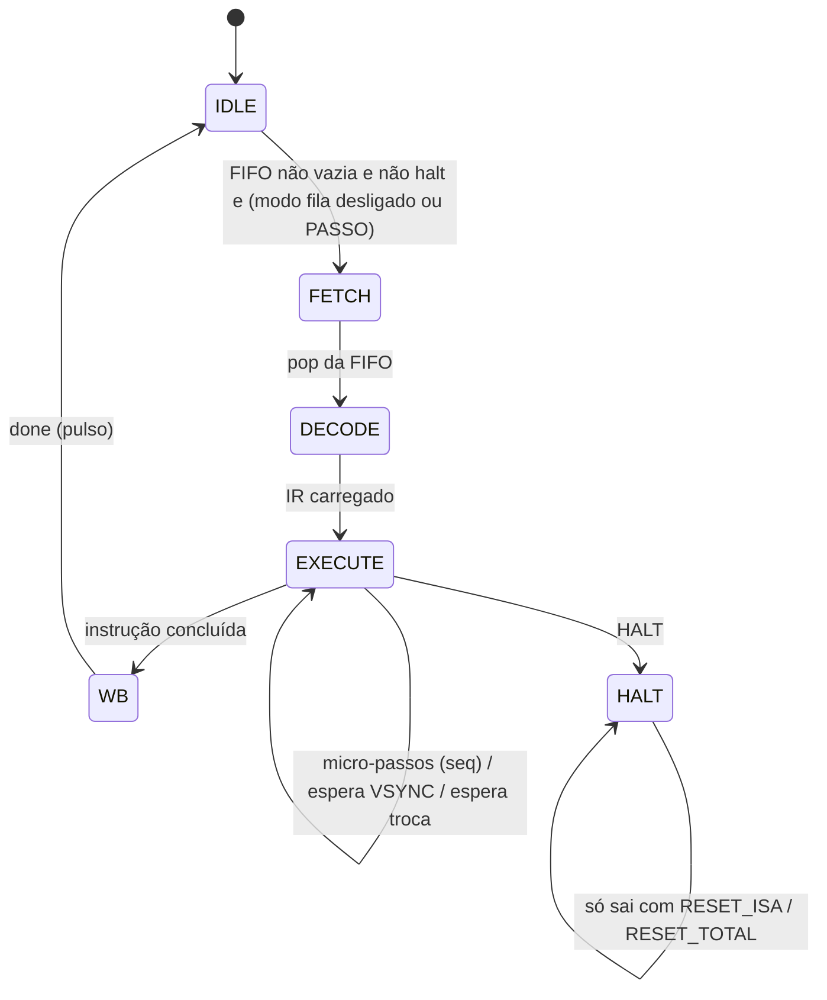

<div align="center">
<h1 align="center">
 TEC499-Jogo-na-placa-DE1-SoC-PBL02
</h1>
</div>

## Descrição do Projeto
<details>
  <summary>Descrição</summary>

  O repositório é um dos componentes da segunda fase de um projeto do desenvolvimento de um jogo que irá funcionar na placa **DE1-SoC**. Na primeira fase foi desenvolvido o núcleo de um coprocessador gráfico em FPGA capaz de desenhar background, sprites e polígonos no VGA. Porém, cada motor gráfico ainda precisava ser controlado individualmente, escrevendo diretamente nos seus registradores.

  Nesta segunda fase o núcleo foi transformado em um **coprocessador gráfico programável**: o software não conhece mais os detalhes internos de cada motor, ele apenas envia **instruções de 32 bits** de uma ISA própria. O hardware busca, decodifica e executa essas instruções, acionando os motores gráficos necessários. A arquitetura segue a organização de um processador convencional, com unidade de busca, registrador de instrução (IR), unidade de controle, banco de registradores, ULA, datapath e registradores de estado. As instruções são enviadas pelo processador ARM (HPS) da placa por meio de PIOs mapeados em memória (**busca passiva**).

  O objetivo final deste projeto é criar um coprocessador gráfico completo para suportar a renderização visual de um protótipo do jogo Bomberman, que será controlado por um driver Linux em Assembly ARM e por uma aplicação em C nas etapas futuras.

  Recursos utilizados nesta segunda fase:
  - Placa Terasic DE1-SoC Board com FPGA Cyclone V SoC 5CSEMA5F31C6 (HPS ARM Cortex-A9 dual-core);
  - Quartus Prime 25.1std.0 Lite Edition e Platform Designer (Qsys);
  - ModelSim - Intel FPGA Starter Edition 2020.1 (simulação);
  - Verilog (comportamental).


<details>
  <summary><h2>Requisitos da 2º Etapa</h2></summary>

  - Definir e documentar uma **ISA de 32 bits**, com formatos de instrução e sintaxe própria;
  - Implementar o ciclo de **busca/execução** de instruções;
  - A arquitetura deve ter: unidade de busca, **registrador de instrução (IR)**, **unidade de controle**, **banco de registradores**, **ULA**, **datapath** e **registrador de status**;
  - Toda operação deve ser consequência da execução de uma instrução da ISA;
  - O **compositor**, a **unidade de controle de quadro** e o **controlador VGA** devem operar continuamente;
  - Mecanismo de **sincronização com o VGA**;
  - Comunicação com **valid / busy / done**;
  - Escolha entre busca **ativa** (memória de instruções interna) ou **passiva** (fila de comandos vinda do ARM via MMIO);
  - Pelo menos um programa escrito no **Assembly da ISA**;
  - Testbench para cada módulo principal e um testbench de integração do coprocessador;
  - Relatório de síntese, utilização de recursos, frequência máxima e análise de timing.
</details>

<details>
<summary><h2>Requisitos funcionais</h2></summary>

### Requisitos funcionais

Requisito | Situação | Onde está
:--- | :---: | :---
ISA de 32 bits documentada (opcode de 6 bits + campos) | Atendido | `control_unit.v`
Unidade de busca (passiva, por fila de comandos) | Atendido | `pio_cmd_iface.v`, `fifo_cmd.v`
Registrador de instrução (IR) | Atendido | `isa_core.v`
Unidade de controle (FSM multiciclo) | Atendido | `control_unit.v`
Banco de registradores de propósito geral (16 × 16 bits) | Atendido | `gpr_bank.v`
ULA | Atendido | `alu.v`
Registrador de status lido pelo ARM | Atendido | `pio_cmd_iface.v` (`pio_status`)
Motores de background, sprites e polígonos como unidades funcionais | Atendido | `motor_background.v`, `motor_sprites.v`, `rasterizador_multi.v`
Unidade de controle de quadro (frame buffer duplo + troca na VSYNC) | Atendido | `frame_buffer_duplo.v`, `coprocessor_core.v`
Compositor e controlador VGA em operação contínua | Atendido | `compositor.v`, `vga_driver.v`
Escrita das memórias de vídeo em tempo de execução (tilemap e padrões) | Atendido | instruções `SET_TILE` e `WR_RAM`
Sincronização com o VGA (`WAIT_VS`, trocas de buffer na VSYNC) | Atendido | `control_unit.v`, `coprocessor_core.v`
Sinais busy / done / estado da fila | Atendido | `pio_status`, LEDs
Modo de execução passo a passo (depuração) | Atendido | comandos `CTRL FILA_ON / PASSO`

</details>

<details>
<summary><h2>Estrutura proposta e decisões tomadas</h2></summary>

### Visão geral da arquitetura

O top-level (`ghrd_top.v`) instancia o sistema do HPS gerado no Platform Designer e o coprocessador. O HPS se comunica com o coprocessador por três PIOs ligados ao barramento. Dentro do coprocessador, as instruções passam por uma interface de comandos, uma FIFO, o núcleo da ISA (IR, unidade de controle, banco de registradores e ULA) e chegam ao banco de registradores gráficos e às memórias de vídeo, que alimentam os motores.

<div align="center">
 <figure>
  
  <figcaption>
    <p align="center">
     <b>Figura 1</b> - Diagrama do Coprocessador Gráfico
    </p>
  </figcaption>
 </figure>
</div>

### Busca passiva

Foi escolhida a **busca passiva**: em vez de uma memória de instruções interna, o coprocessador recebe as instruções do ARM por uma fila de comandos. Essa decisão foi tomada porque:
- o jogo final será executado no ARM, então é ele quem decide o que desenhar a cada quadro (posição do jogador, inimigos, explosões);
- permite trocar o programa de teste sem recompilar a FPGA.


### Domínios de clock e sincronização

Foram mantidos os dois PLLs da primeira etapa, gerados a partir do `CLOCK_50`:
-  clock de pixel de 25 MHz (`clk_pix`);
- clock de sistema de 100 MHz (`clk_sys`), usado pela interface de comandos, pela ISA, pelo banco de registradores gráficos e pelas RAMs de vídeo.

O reset global combina o `hps_fpga_reset_n` com os sinais `locked` dos dois PLLs. Os cruzamentos entre os domínios são assim:
- **VSYNC → clk_sys:** sincronizador de 3 flip-flops com detecção de borda, usado pela instrução `WAIT_VS` e pelo bit de status;
- **Pedidos de troca (clk_sys → clk_pix):** cada pedido inverte um *toggle*, que atravessa 3 flip-flops e é convertido de volta em pulso no domínio de pixel;
- **Atributos gráficos (clk_sys → clk_pix):** todos os atributos de sprites, polígonos, camadas e scroll são concatenados em um único vetor, registrados uma vez no domínio de pixel (`attr_meta`) e só são copiados para os registradores usados pelos motores na borda da VSYNC. Assim, uma cena nunca é desenhada com metade dos atributos antigos e metade novos;
- **Buffer visível (clk_pix → clk_sys):** `bg_frente` e `fb_frente` passam por 2 flip-flops e são usados pela unidade de controle para saber quando uma troca terminou.


### Interface de comandos (pio_cmd_iface)

O ARM escreve a palavra de 32 bits em `pio_cmd_data` e gera uma borda de subida em `pio_cmd_push` (escreve 1 e depois 0). A interface detecta essa borda e se o opcode for `62` (**CTRL**), executa um comando de controle sem passar pela FIFO, caso contrário, coloca a palavra na FIFO (se ela estiver cheia, a palavra é descartada, por isso o software deve consultar o status antes de enviar).

Comandos de controle (`CTRL`, campo `ir[9:6]`):

Código | Comando | Função
:---: | :--- | :---
1 | `FILA_ON` | Ativa o modo fila: a FIFO apenas acumula instruções
2 | `FILA_OFF` | Desativa o modo fila: a FIFO volta a ser esvaziada em sequência
3 | `PASSO` | Executa uma única instrução da fila (com o modo fila ativo)
4 | `RESET_ISA` | Reinicia apenas o núcleo da ISA (FIFO, IR, GPRs e FSM)
5 | `RESET_TOTAL` | Reinicia a ISA e os registradores gráficos
6 | `VER_QTD` | `pio_status` passa a mostrar a quantidade de instruções na FIFO
7 | `VER_STATUS` | `pio_status` volta ao formato normal

O modo fila e o passo a passo foram criados para depuração: é possível carregar várias instruções e executá-las uma a uma, observando o efeito de cada uma na tela e nos LEDs.

### Núcleo da ISA (isa_core)

O `isa_core` agrupa a FIFO, o registrador de instrução, o banco de registradores, a ULA e a unidade de controle. A FIFO possui saída registrada, então o IR é carregado no ciclo seguinte ao `pop`. O banco de registradores possui 16 registradores de 16 bits, com `R0` fixo em zero, duas portas de leitura (`Rs` e `Rt`) e uma de escrita (`Rd`). A ULA de 16 bits realiza `ADD`, `SUB`, `AND`, `OR` e `MOV`.

Os registradores de propósito geral permitem que o movimento seja feito por **deslocamento relativo**: o programa guarda a velocidade em um registrador (por exemplo `R1 = 2`) e as instruções `MOV_BG`, `SPR_MOV` e `PLY_MOV` somam o valor dos registradores à posição atual do objeto.

### Unidade de controle

A unidade de controle é uma máquina de estados multiciclo:



- **IDLE:** aguarda instrução na FIFO;
- **FETCH:** retira a instrução da FIFO (`fifo_pop`);
- **DECODE:** o IR é carregado e o contador de micro-passos é zerado;
- **EXECUTE:** gera os sinais para o banco gráfico, memórias de vídeo, GPRs e ULA. Instruções que precisam escrever vários registradores gráficos (por exemplo `SPR_POS`, que seleciona o sprite e escreve X e Y) usam um contador interno `seq`;
- **WB:** fim da instrução, gera o pulso `done`;
- **HALT:** trava o núcleo até um reset por software.

Instruções de sincronização ficam em EXECUTE até a condição ser atendida:
- `WAIT_VS` espera a próxima borda de VSYNC;
- `SWAP_FB` e `SWAP_BG` só terminam quando o buffer visível realmente trocou. Isso garante que as instruções seguintes nunca alterem o quadro que está prestes a ser apresentado.

### Unidade de controle de quadro (frame buffer duplo)

Diferente da primeira fase do projeto, onde os motores enviavam a cor diretamente ao VGA, nesta fase foi adicionado um **frame buffer duplo** de 2 × 320 × 240 bytes. O compositor escreve continuamente o quadro no buffer escondido, enquanto o VGA lê o buffer visível . O fluxo de uma troca é:

1. `SWAP_FB` pede a troca (`swap_fb_request`);
2. na próxima VSYNC os atributos novos são copiados e a troca fica "armada";
3. durante esse quadro a cena nova é composta inteira no buffer escondido;
4. na VSYNC seguinte os buffers são trocados e a instrução termina.

Essa decisão foi tomada para que uma cena nunca seja exibida pela metade, mesmo que o ARM demore para enviar todas as instruções de um quadro.

### Memórias de vídeo

As memórias continuam sendo blocos RAM dual-port gerados pelo Quartus (`altsyncram`), inicializados por arquivos `.mif`, mas agora possuem **porta de escrita ligada à ISA**:
- Duas RAMs de tilemap (A e B) de 2048 × 8 bits, com troca na VSYNC por `SWAP_BG`;
- RAM de padrões de tiles com 16384 × 8 bits (256 tiles de 8 × 8) (`padroes_tiles.mif`);
- RAM de padrões de sprites com 8192 × 8 bits (32 padrões de 16 × 16) (`padroes_sprites.mif`).

A instrução `SET_TILE` escreve uma posição do tilemap no buffer escondido, no visível ou em ambos, e `WR_RAM` escreve um byte qualquer em uma das quatro memórias. Com isso, a limitação da primeira etapa (memórias fixas, sem escrita em tempo de execução) foi resolvida.

### Motores gráficos

Os motores foram reaproveitados como unidades funcionais, com pequenas alterações:
- **Motor de background:** pipeline de 3 estágios, tilemap 40 × 30, tiles 8 × 8 e scroll com *wrapping* por subtrações condicionais de 320/240;
- **Motor de sprites:** 32 sprites de 16 × 16 avaliados em paralelo, com espelhamento horizontal e vertical. A escolha entre sprites no mesmo pixel é feita por uma **árvore de comparação** de prioridade (em caso de empate vence o sprite de maior índice). O índice de cor `0` é transparente;
- **Rasterizador:** 6 formas (retângulo, quadrado, triângulo retângulo, isósceles com ápice para cima ou para baixo e escaleno), definidas por origem (X, Y) e tamanho. A geometria de cada slot é pré-calculada uma vez por ciclo e o teste de inclusão usa funções de aresta com aritmética inteira, em um pipeline de 3 estágios.

### Compositor e regra de prioridade

O compositor combina as três camadas com transparência pelo índice `0`. A prioridade entre sprites e polígonos agora é **configurável** pela instrução `SET_PRI`.

### Saída VGA

O `vga_driver` é usado apenas como gerador de timing (HSYNC, VSYNC e coordenadas). A cor é lida do frame buffer e convertida de RGB332 para os 8 bits por canal do DAC. Cor, HSYNC, VSYNC e BLANK são registrados juntos, com o mesmo atraso.

</details>

<details>
 <summary><h2>Análise de Recursos</h2></summary>
 Esta seção consolida os resultados de síntese e análise de timing obtidos com o Quartus Prime 25.1std.0 Lite para o dispositivo Cyclone V 5CSEMA5F31C6 (DE1-SoC). Os números são do projeto completo (top-level <code>ghrd_top</code>), incluindo o sistema do HPS.

### Utilização de recursos

Recurso | Projeto completo | Disponível | Uso
:--- | ---: | ---: | :---:
ALMs | 5.324 | 32.070 | 17 %
Registradores | 8.622 | — | —
Bits de memória em bloco | 1.985.569 | 4.065.280 | 49 %
Blocos M10K | 250 | 397 | 63 %
Blocos DSP | 12 | 87 | 14 %
PLLs | 2 | 6 | 33 %
Pinos | 382 | 457 | 84 %

Distribuição dentro do coprocessador (`coprocessor_core`):

Módulo | ALMs | Registradores | Bits de memória | M10K | DSP
:--- | ---: | ---: | ---: | ---: | ---:
**coprocessor_core (total)** | **2.845** | **4.896** | **1.459.233** | **182** | **12**
rasterizador_multi | 882 | 620 | 0 | 0 | 12
banco_registradores | 666 | 1.170 | 0 | 0 | 0
motor_sprites | 487 | 327 | 0 | 0 | 0
isa_core (FIFO + IR + GPR + ULA + UC) | 313 | 321 | 1.024 | 1 | 0
frame_buffer_duplo | 62 | 12 | 1.228.800 | 152 | 0
vga_driver | 38 | 41 | 0 | 0 | 0
motor_background | 26 | 40 | 0 | 0 | 0
pio_cmd_iface | 15 | 42 | 0 | 0 | 0
compositor | 5 | 0 | 0 | 0 | 0
RAMs de vídeo (tilemaps + padrões) | 4 | 2 | 229.376 | 28 | 0

O restante (cerca de 2.326 ALMs e 68 M10K) pertence ao sistema do HPS gerado no Platform Designer (interfaces, JTAG UART e memória on-chip de 64 KB).

O item que mais cresceu em relação à primeira etapa foi a memória: o **frame buffer duplo sozinho ocupa 1,2 Mbit e 152 blocos M10K** (38 % dos blocos da FPGA). A lógica da ISA em si é pequena (cerca de 313 ALMs), mostrando que transformar o núcleo em um coprocessador programável custou pouco em lógica. O banco de registradores gráficos continua grande porque guarda os atributos de 32 sprites e polígonos em registradores, que são lidos todos ao mesmo tempo pelos motores.

### Timing e frequências

Fmax reportado no modelo Slow 1100 mV 85 °C:

Domínio | Frequência alvo | Fmax | Slack de setup | Slack de hold
:--- | :---: | :---: | :---: | :---:
`clk_sys` (pllpara100) | 100 MHz | 118,2 MHz | +1,524 ns | +0,245 ns
`clk_pix` (meu_pll) | 25 MHz | 47,49 MHz | +2,811 ns | +0,287 ns
`CLOCK_50` | 50 MHz | 94,47 MHz | +3,114 ns | +0,272 ns
`altera_reserved_tck` (JTAG) | — | 65,34 MHz | +9,306 ns | +0,361 ns

Todos os domínios do coprocessador fecham com folga. O domínio de 100 MHz, onde roda a ISA, é o mais apertado (cerca de 18 % de margem). Os caminhos com slack negativo que aparecem no relatório pertencem à interface DDR3 do HPS, e não ao coprocessador.

### Desempenho funcional

- **Execução de instruções:** cada instrução passa por IDLE → FETCH → DECODE → EXECUTE → WB, levando cerca de **5 ciclos de `clk_sys` (50 ns)** para instruções simples e até 8 ciclos (80 ns) para as que fazem várias escritas, como `PLY_DRAW`. Isso permite executar mais de 10 milhões de instruções por segundo;
- **Envio pelo ARM:** cada instrução exige 3 escritas MMIO (dado, push = 1, push = 0), então o gargalo real é o barramento HPS → FPGA, e não o coprocessador;
- **Taxa de quadros:** o VGA é gerado a 60 Hz. Como `SWAP_FB` só termina após o quadro novo ter sido composto inteiro, um laço que chama `SWAP_FB` a cada quadro atualiza a cena a cada 2 quadros VGA (**cerca de 30 quadros por segundo**);
- **Latências de sincronização:** `WAIT_VS` dura até 1 quadro (16,7 ms); `SWAP_BG` até 1 quadro; `SWAP_FB` entre 1 e 2 quadros.

### Gargalos identificados

Os principais gargalos observados na arquitetura atual são:
- **Envio instrução a instrução pelo PIO:** três acessos MMIO por instrução e a necessidade de consultar o status para não perder palavras quando a FIFO enche;
- **Frame buffer duplo:** consome a maior parte da memória em bloco da FPGA, limitando a adição de novos recursos que usem RAM;
- **Avaliação paralela de 32 sprites e polígonos:** a árvore de prioridade dos sprites e os multiplicadores do rasterizador são os maiores blocos de lógica no domínio de pixel.

### Limitações conhecidas

- `JMP` e `BEQ` estão reservados na ISA, mas são executados como NOP, pois na busca passiva o fluxo é controlado pelo ARM;
- Se a FIFO estiver cheia, a palavra enviada é descartada silenciosamente; o software deve verificar o bit `fifo_full` antes de enviar;

### Melhorias possíveis

Com base na análise de recursos e timing, as melhorias mais promissoras são:
- Substituir os PIOs por uma interface Avalon-MM com escrita direta na FIFO (uma escrita por instrução) ou por DMA, removendo o gargalo do envio;
- Reduzir o frame buffer (por exemplo, compondo linha a linha com *line buffers*), liberando memória para mais padrões e uma segunda camada de background;
- Gerar uma interrupção para o ARM no fim de cada quadro, evitando que o software fique consultando o status.

### Conclusão da análise

O coprocessador utiliza uma fração modesta da lógica da placa. O custo de tornar o núcleo programável (FIFO, IR, unidade de controle, GPRs e ULA) foi pequeno, enquanto o maior consumo vem do frame buffer duplo, que foi a escolha feita para garantir quadros completos e sem tearing. Os pontos de atenção se concentram na interface de envio de instruções e no uso de memória.

</details>
</details>

## Estrutura Implementada

<details>
<summary>Módulos do Sistema</summary>

O top-level da placa é `ghrd_top.v`.

Arquivo | Função
:--- | :---
`ghrd_top.v` | Top-level da DE1-SoC: instancia o `soc_system` (HPS + PIOs) e o coprocessador
`coprocessor_core.v` | Top-level do coprocessador: PLLs, sincronizações, ISA, banco gráfico, memórias, motores, frame buffer e VGA
`pio_cmd_iface.v` | Interface com os PIOs: detecção de push, comandos CTRL e registrador de status
`fifo_cmd.v` | Fila de instruções de 32 posições × 32 bits
`isa_core.v` | Núcleo da ISA: FIFO, IR, GPRs, ULA e unidade de controle
`control_unit.v` | Unidade de controle (FSM) e decodificação das instruções
`gpr_bank.v` | Banco de 16 registradores de 16 bits (R0 = 0)
`alu.v` | ULA de 16 bits
`banco_registradores.v` | Registradores gráficos (scroll, sprites, polígonos, camadas, trocas)
`motor_background.v` | Motor de background (tilemap)
`motor_sprites.v` | Motor de sprites
`rasterizador_multi.v` | Rasterizador de polígonos
`compositor.v` | Composição das camadas com prioridade configurável
`frame_buffer_duplo.v` | Frame buffer duplo 320 × 240 (unidade de controle de quadro)
`vga_driver.v` | Timing VGA 640 × 480
`ram_*.v`, `*.mif` | RAMs de vídeo (IP altsyncram) e seus conteúdos iniciais
`meu_pll*.v`, `pllpara100*.v` | PLLs de 25 MHz e 100 MHz

### Registrador de Instrução e Unidade de Controle
<details>
<summary>Busca, decodificação e execução</summary>

A instrução retirada da FIFO é guardada no IR, de onde saem o opcode (`ir[5:0]`), os índices de registradores e os campos imediatos. A unidade de controle decodifica o opcode e, em EXECUTE, gera os sinais para o datapath: escrita nos GPRs, operação da ULA, escrita no banco de registradores gráficos (`gfx_wr_en`, `gfx_addr`, `gfx_data`) e escrita nas memórias de vídeo (`mem_we`, `mem_addr`, `mem_data`).
</details>
<hr>

### Banco de Registradores e ULA
<details>
<summary>Datapath de propósito geral</summary>

O banco possui 16 registradores de 16 bits com leitura combinacional em duas portas (`Rs = ir[13:10]`, `Rt = ir[17:14]`) e escrita síncrona (`Rd = ir[9:6]`). `R0` sempre retorna zero, o que permite usar `R0` como "sem deslocamento" nas instruções de movimento. A ULA recebe `Rs` e `Rt` e devolve o resultado para `Rd`. No caso do `MOVI`, o valor escrito vem do campo imediato da instrução.
</details>
<hr>

### Motores Gráficos
<details>
<summary>Unidades funcionais gráficas</summary>

- **Motor de Background:** tilemap de 40 × 30 entradas e tiles de 8 × 8 pixels (256 padrões), com scroll horizontal e vertical e repetição da cena. Pode ser trocado entre dois tilemaps (A e B) e editado em tempo de execução com `SET_TILE` / `WR_RAM`.
- **Motor de Sprites:** até 32 sprites simultâneos de 16 × 16 pixels, com posição (X, Y), padrão, habilitação, prioridade e espelhamento horizontal/vertical, todos configurados por instruções (`SPR_POS`, `SPR_MOV`, `SPR_CFG`, `SPR_PAT`, `SPR_HIDE`).
- **Rasterizador de Polígonos:** cada polígono terá parâmetros de forma, origem, tamanho, cor e habilitação. Formas disponíveis (campo `tipo`):

  Tipo | Forma
  :---: | :---
  0 | Retângulo (largura = tamanho, altura = 3/4 do tamanho)
  1 | Triângulo retângulo (ângulo reto em baixo à esquerda)
  2 | Triângulo isósceles com ápice para cima
  3 | Triângulo isósceles com ápice para baixo
  4 | Triângulo escaleno
  5 | Quadrado

</details>
<hr>

### Controle de Quadro, Compositor e Driver VGA
<details>
<summary>Composição de cena e saída de vídeo</summary>

- **Compositor:** combina background, polígonos e sprites com transparência pelo índice `0` e prioridade configurável entre sprites e polígonos (`SET_PRI`).
- **Frame buffer duplo:** recebe o quadro composto no buffer escondido e entrega o buffer visível ao VGA. A troca acontece somente na VSYNC.
- **Driver VGA:** gera o timing de 640 × 480 a 60 Hz e as coordenadas de varredura. Cada pixel lógico de 320 × 240 é duplicado em 2 × 2 na saída.

</details>
<hr>

</details>

## ISA

<details>
<summary>Formatos de instrução</summary>

Todas as instruções possuem **32 bits**, com o opcode sempre nos 6 bits menos significativos. Foram definidos quatro formatos:

```
        31        :      18 17   :  14 13      10 9   :    6 5   :    0
  R  : |        0          |    Rt    |    Rs    |    Rd    |  OPCODE  |
  I  : |       Imm[17:0]              |    Rs    |    Rd    |  OPCODE  |
  G  : |          campos gráficos      ir[31:6]             |  OPCODE  |
  J  : |          alvo / flags         ir[31:6]             |  OPCODE  |
```

- **R:** operações entre registradores (`ADD`, `SUB`, `AND`, `OR`, `MOV`) e movimentos relativos, que usam `Rs` como deslocamento em X e `Rt` como deslocamento em Y;
- **I:** carga de imediato (`MOVI`), com valor de 16 bits em `ir[29:14]`;
- **G:** instruções gráficas, cujos campos são definidos individualmente;
- **J:** desvios (reservados).
<hr>
</details>

<details>
<summary>Tabela de instruções</summary>

Opcode | Mnemônico | Formato | Campos (bits do IR) | Função
:---: | :--- | :---: | :--- | :---
0 | `NOP` | — | — | Nenhuma operação
1 | `WAIT_VS` | G | — | Espera a próxima borda de VSYNC
2 | `SWAP_FB` | G | — | Troca o frame buffer na VSYNC e espera a troca terminar
3 | `SET_LAYER` | G | `[8:6]` = {poly, sprite, bg} | Habilita/desabilita as camadas gráficas
4 | `SET_BG_X` | G | `[13:6]` = x | Scroll horizontal absoluto
5 | `SET_BG_Y` | G | `[13:6]` = y | Scroll vertical absoluto
6 | `MOV_BG` | R | `Rs` = dx, `Rt` = dy | Movimentação do background
7 | `SPR_POS` | G | `[31:27]` = id, `[26:18]` = x, `[17:9]` = y | Posição absoluta do sprite
8 | `SPR_MOV` | R | `[22:18]` = id, `Rs` = dx, `Rt` = dy | Movimentação do sprite
9 | `SPR_CFG` | G | `[31:27]` = id, `[10]` = enable, `[9]` = flip H, `[8]` = flip V, `[7:6]` = prioridade | Configura o sprite
10 | `SPR_HIDE` | G | `[31:27]` = id | Desabilita o sprite
11 | `SPR_SEL` | G | `[10:6]` = id | Seleciona o sprite ativo no banco gráfico
12 | `SPR_PAT` | G | `[31:27]` = id, `[10:6]` = padrão | Escolhe o padrão 16 × 16 do sprite
13 | `PLY_DRAW` | G | `[31:30]` = slot, `[29:27]` = tipo, `[26:18]` = x, `[17:9]` = y | Define forma e origem e habilita o polígono
14 | `PLY_ADJ` | G | `[24:23]` = slot, `[22:14]` = tamanho | Ajusta o tamanho do polígono
15 | `PLY_COR` | G | `[31:30]` = slot, `[13:6]` = cor | Define a cor (RGB332) do polígono
16 | `PLY_MOV` | R | `[19:18]` = slot, `Rs` = dx, `Rt` = dy | Movimentação do polígono
17 | `PLY_HIDE` | G | `[31:30]` = slot | Desabilita o polígono
18 | `SET_PRI` | G | `[6]` = sprite sobre polígono | Prioridade entre sprites e polígonos
19 | `ADD` | R | `Rd, Rs, Rt` | Rd = Rs + Rt
20 | `SUB` | R | `Rd, Rs, Rt` | Rd = Rs − Rt
21 | `MOVI` | I | `Rd`, `[29:14]` = imm16 | Rd = imm16
22 | `MOV` | R | `Rd, Rs` | Rd = Rs
23 | `AND` | R | `Rd, Rs, Rt` | Rd = Rs & Rt
24 | `OR` | R | `Rd, Rs, Rt` | Rd = Rs or Rt
25 | `JMP` | J | — | Reservado (executado como NOP)
26 | `BEQ` | J | — | Reservado (executado como NOP)
27 | `SWAP_BG` | G | — | Troca o tilemap A ↔ B na VSYNC e espera a troca terminar
28 | `SET_TILE` | G | `[31]` = ambos, `[30]` = visível, `[29:25]` = linha, `[24:19]` = coluna, `[13:6]` = tile | Escreve uma posição do tilemap
29 | `WR_RAM` | G | `[31:30]` = memória, `[27:14]` = endereço, `[13:6]` = dado | Escreve um byte em uma memória de vídeo
62 | `CTRL` | — | `[9:6]` = comando | Comando de controle (tratado pela `pio_cmd_iface`, não entra na FIFO)
63 | `HALT` | — | — | Para o núcleo até um reset por software

Observações:
- Em `SET_TILE`, com `[31] = 0` a escrita vai para o tilemap escondido (`[30] = 0`) ou para o visível (`[30] = 1`); com `[31] = 1` vai para os dois. Posições fora de 40 × 30 são ignoradas;
- Em `WR_RAM`, a memória é `00` = tilemap A, `01` = tilemap B, `10` = padrões de tiles, `11` = padrões de sprites. Endereços acima de 2047 nos tilemaps são ignorados;
- Cores no formato **RGB332** (`RRRGGGBB`); o índice `0x00` é transparente.
<hr>
</details>

<details>
<summary>Sintaxe do Assembly e programa de demonstração</summary>

A sintaxe definida pela equipe segue o padrão `MNEMÔNICO destino, operandos`, com registradores escritos como `R0`–`R15`, números em decimal ou hexadecimal (`0x`) e comentários iniciados por `;`:

```asm
; ---------- Programa de demonstração ----------
; Inicialização
        CTRL      RESET_TOTAL        ; zera ISA e registradores gráficos
        SET_LAYER 0b111              ; liga background, sprites e polígonos
        SET_PRI   1                  ; sprite > polígono > background
        MOVI      R1, 2              ; velocidade do sprite em X
        MOVI      R2, 1              ; velocidade do background

; Sprite 0: Bomberman no centro
        SPR_PAT   0, 0               ; sprite 0 usa o padrão 0
        SPR_POS   0, 152, 112        ; posição (x, y)
        SPR_CFG   0, EN, PRI=1       ; habilita, sem espelhamento

; Polígono no slot 1: triângulo isósceles verde
        PLY_DRAW  1, 2, 60, 40       ; slot, tipo, x, y
        PLY_ADJ   1, 48              ; tamanho 48
        PLY_COR   1, 0x1C            ; verde em RGB332

; Laço de animação (repetido pelo ARM a cada quadro)
loop:
        SPR_MOV   0, R1, R0          ; sprite 0 anda 2 pixels para a direita
        MOV_BG    R2, R0             ; background rola 1 pixel
        PLY_MOV   1, R0, R2          ; polígono desce 1 pixel
        SWAP_FB                      ; apresenta o quadro na VSYNC
        JMP       loop               ; laço controlado pelo programa no ARM
```

Exemplos de codificação (palavras enviadas pelo ARM):

Instrução | Palavra de 32 bits
:--- | :---:
`CTRL FILA_ON` | `0x0000007E`
`SET_LAYER 0b111` | `0x000001C3`
`SET_BG_X 40` | `0x00000A04`
`MOVI R1, 16` | `0x00040055`
`SPR_POS 0, 100, 80` | `0x0190A007`
`SPR_MOV 0, R1, R0` | `0x00000408`
`PLY_DRAW 1, 2, 60, 40` | `0x50F0500D`
`SWAP_FB` | `0x00000002`
`HALT` | `0x0000003F`
<hr>
</details>

## Mapa de Registradores

<details>
<summary>Interface MMIO com o ARM (PIOs)</summary>

Os PIOs ficam na ponte *lightweight HPS-to-FPGA* (base `0xFF200000` no ARM). Os endereços dos deslocamentos dentro da ponte (`hps_0.h`) são:

Endereço | Nome | Direção | Função
:---: | :--- | :---: | :---
`0x10010` | PIO_CMD_DATA | ARM → FPGA | Palavra de 32 bits da instrução
`0x10020` | PIO_CMD_PUSH | ARM → FPGA | Borda de subida (0 → 1) envia a palavra
`0x10030` | PIO_STATUS | FPGA → ARM | Status do coprocessador (8 bits)

Protocolo de envio: o ARM escreve a instrução em `PIO_CMD_DATA`, escreve `1` e depois `0` em `PIO_CMD_PUSH` e lê `PIO_STATUS` para acompanhar a execução.
<hr>
</details>

<details>
<summary>Registrador de status</summary>

Formato normal (`CTRL VER_STATUS`, padrão):

Bit | Nome | Significado
:---: | :--- | :---
7 | `fb_frente` | Frame buffer visível (0 = A, 1 = B)
6 | `bg_frente` | Tilemap visível (0 = A, 1 = B)
5 | `halt` | Núcleo parado por `HALT`
4 | `vsync` | Pulso de VSYNC
3 | `fifo_empty` | FIFO vazia
2 | `fifo_full` | FIFO cheia (novas palavras serão descartadas)
1 | `modo_fila` | Modo fila ativo
0 | `busy` | Executando uma instrução

Formato de quantidade (`CTRL VER_QTD`): `[7] = 1`, `[6] = modo_fila`, `[5:0] = número de instruções na FIFO (0 a 32)`.
<hr>
</details>

<details>
<summary>Banco de registradores gráficos (interno)</summary>

Diferente da primeira fase do projeto, agora esses registradores não são mais acessados pelo software. Eles são escritos pela unidade de controle ao executar as instruções.

Endereço | Nome | Função
:---: | :--- | :---
`0x01` / `0x02` | BG_SCROLL_X / Y | Scroll absoluto do background
`0x03` | SPRITE_SEL | Sprite selecionado (0 a 31)
`0x04` / `0x05` | SPRITE_X / Y | Posição do sprite selecionado
`0x06` | SPRITE_FLAGS | `[5:3]` prioridade, `[2]` enable, `[1]` flip H, `[0]` flip V
`0x07` | SPRITE_PADRAO | Padrão do sprite selecionado
`0x08` | LAYER_ENABLE | `[0]` background, `[1]` sprites, `[2]` polígonos
`0x0B` | SWAP_BG | Pedido de troca do tilemap
`0x0C` | SPRITE_OVER_POLY | Prioridade entre sprites e polígonos
`0x0D` | SWAP_FB | Pedido de troca do frame buffer
`0x0E` / `0x0F` | BG_DELTA_X / Y | Scroll += valor
`0x21` / `0x22` | SPRITE_DELTA_X / Y | Posição do sprite selecionado += valor
`0x30` a `0x4F` | POLY_CONFIG | `0x30 + slot × 8 + campo` (0 = x, 1 = y, 2 = tamanho, 3 = tipo, 4 = nº de vértices, 6 = cor, 7 = habilitado)
`0x50` a `0x57` | POLY_DELTA | `0x50 + slot × 2` (+0 = dx, +1 = dy)
<hr>
</details>

## Barramentos
<details>
<summary>Barramentos</summary>

Barramento | Tamanho | Descrição
:---: | :--- |:---
PIO Data | 32 | Instrução enviada pelo ARM
PIO Push | 1 | Sinal de envio (borda de subida)
PIO Status | 8 | Estado do coprocessador lido pelo ARM
Gfx Address | 16 | Endereço do registrador gráfico escrito pela unidade de controle
Gfx Data | 9 | Dado do registrador gráfico (cobre coordenadas até 319)
Mem | 4 + 14 + 8 | Habilitação por memória, endereço e dado das RAMs de vídeo
VGA Out | 29 | Sinais físicos de vídeo

### PIO Data / Push
O ARM coloca a instrução de 32 bits em `pio_cmd_data` e gera uma borda de subida em `pio_cmd_push`. A `pio_cmd_iface` sincroniza o push com o `clk_sys`, detecta a borda e envia a palavra para a FIFO (ou executa o comando de controle, se o opcode for `CTRL`).

### PIO Status
Barramento de 8 bits lido pelo ARM, com os bits de `busy`, estado da FIFO, `halt`, VSYNC e buffers visíveis, ou com a quantidade de instruções na FIFO (ver [Registrador de status](#mapa-de-registradores)). É por ele que o software implementa o handshake.

### Gfx Address / Data
Barramento interno entre a unidade de controle e o `banco_registradores`. Quem o controla é a unidade de controle, e não o usuário. O dado de 9 bits é o tamanho necessário para representar a coordenada X máxima (319).

### Mem
Barramento interno de escrita nas memórias de vídeo: `mem_we[3:0]` seleciona a memória (`[0]` tilemap A, `[1]` tilemap B, `[2]` padrões de tiles, `[3]` padrões de sprites), `mem_addr` possui 14 bits e `mem_data` 8 bits.

### VGA Out
- Cores (24 bits): `VGA_R`, `VGA_G` e `VGA_B`, com 8 bits cada, obtidos a partir do pixel RGB332 do frame buffer;
- Sincronismo (5 bits): `VGA_HS`, `VGA_VS`, `VGA_CLK`, `VGA_BLANK_N` e `VGA_SYNC_N`.
<hr>
</details>

## Especificação do Hardware

<details>
<summary>Placa e ferramentas</summary>

Item | Especificação
:--- | :---
Placa | Terasic DE1-SoC
FPGA | Intel Cyclone V SoC 5CSEMA5F31C6
HPS | ARM Cortex-A9 dual-core
Clock de referência | `CLOCK_50` (50 MHz)
Clocks gerados | 25 MHz (pixel) e 100 MHz (sistema)
Saída de vídeo | Conector VGA da placa (DAC ADV7123)
Ferramenta de síntese | Quartus Prime 25.1std.0 Lite Edition

### LEDs da placa

LED | Significado
:---: | :---
LEDR[0] | `busy` (executando instrução)
LEDR[1] | Modo fila ativo
LEDR[2] | FIFO cheia
LEDR[3] | FIFO vazia
LEDR[4] | `HALT`
LEDR[9:5] | Modo normal: opcode da última instrução. Modo fila: quantidade de instruções na FIFO

<hr>
</details>

## Testes

<details>
<summary>Testes</summary>

### Software de teste no HPS
<details>
<summary>Driver em Assembly e programa de testes</summary>

Os testes na placa são feitos por um programa executado no Linux do HPS. Ele não depende das chaves nem dos botões da placa: o modo fila, o passo a passo e os resets são comandos `CTRL` enviados por software.

Arquivo | Função
:--- | :---
`coproc_driver.s` | Driver em **Assembly ARMv7**: mapeia a ponte *lightweight* (`0xFF200000`) com `open`/`mmap2` em `/dev/mem` e implementa o protocolo de envio pelos PIOs
`coproc_driver.h` | Interface C do driver (protótipos, códigos de retorno e bits de status)
`isa_coproc.h` | Macros de codificação de todas as instruções da ISA
`test_grafico_hps.c` | Programa de testes: menu com 15 cenários, verificações automáticas e execução de arquivos de instruções
`testes/t00` … `t16` | Roteiros de instruções em hexadecimal, executados com `-f` ou `-p`

#### Funções do driver

Função | O que faz
:--- | :---
`coproc_init()` / `coproc_close()` | Abre `/dev/mem` e mapeia/desmapeia a ponte LW (exige `sudo`)
`coproc_status()` | Lê o `pio_status`
`coproc_send(instr)` | Envia a instrução e espera ela terminar (FIFO vazia e `busy = 0`); se a instrução for o próprio `HALT`, terminar em `HALT` conta como sucesso
`coproc_enfileira(instr)` | Só coloca a instrução na FIFO, esperando enquanto ela estiver cheia
`coproc_espera()` | Espera a FIFO esvaziar e o núcleo ficar livre
`coproc_ctrl(cmd)` | Envia um comando `CTRL` genérico; vale na hora, mesmo com a FIFO cheia ou em `HALT`
`coproc_modo_fila(on)` | `CTRL FILA_ON` / `CTRL FILA_OFF`
`coproc_passo()` | `CTRL PASSO` e espera a instrução terminar
`coproc_reset(total)` | `CTRL RESET_ISA` (0) ou `CTRL RESET_TOTAL` (1)
`coproc_fila_qtd()` | `CTRL VER_QTD`, lê a quantidade na FIFO e volta para `VER_STATUS`

Toda espera tem limite de 2 s. Os retornos negativos indicam o motivo da falha: `-1` FIFO cheia, `-2` timeout, `-3` coprocessador em `HALT`, `-4` driver não iniciado e `-5` hardware sem suporte ao comando `CTRL` (`.sof` antigo gravado).

#### Compilação e execução

```bash
gcc -std=c99 -O2 -Wall -o test_grafico test_grafico_hps.c coproc_driver.s
```

Modo | Comando
:--- | :---
Menu interativo | `sudo ./test_grafico`
Um cenário | `sudo ./test_grafico 7`
Todos os cenários em sequência | `sudo ./test_grafico todos`
Arquivo de instruções | `sudo ./test_grafico -f testes/t03_sprite_mostrar.txt`

O menu também possui as opções `A` (todos), `S` (mostrar status), `R` (reset total) e `0` (sair).

#### Preparação automática

Antes de qualquer teste, o programa confere se o hardware está pronto:
1. Liga e desliga o modo fila e confere o bit `modo_fila` do status. Se o bit não mudar, o `.sof` gravado não reconhece os comandos `CTRL`;
2. Faz um reset por software (total no menu; só da ISA nos modos `-f`/`-p`, para manter a cena entre arquivos) e confere que a FIFO ficou vazia e o `HALT` foi limpo;
3. Envia `SWAP_FB` e confere que o bit `fb_frente` trocou, o que comprova que o VGA está gerando VSYNC.

Antes de cada cenário do menu, a tela é levada a um estado conhecido (todas as camadas ligadas, scroll em (0, 0), `SET_PRI 1`, todos os sprites e polígonos escondidos) e os registradores `R1`–`R7` recebem as velocidades `-3` a `+3`, usadas pelas instruções de movimento relativo.

Cada `SWAP_FB` bloqueia por cerca de 2 quadros, então ele também controla a velocidade das animações.
</details>
<hr>

### Cenários de teste na placa
<details>
<summary>Menu de testes (test_grafico)</summary>

Os cenários 7 a 10 possuem **verificações automáticas** que leem o `pio_status` e imprimem `ok` / `FALHA`; no final o programa mostra o total. Nos demais, o resultado é conferido no monitor VGA.

#### Cenário 1 - Scroll do background
<details>
<summary>Absoluto e relativo</summary>

**Instruções:** `SET_LAYER`, `SET_BG_X`, `SET_BG_Y`, `MOVI`, `MOV_BG`, `SWAP_FB`

**Procedimento:**
1. Só a camada de background é habilitada, com scroll em (0, 0);
2. Scroll absoluto para (80, 40);
3. `R1 = 2`, `R2 = 1` e 40 quadros de `MOV_BG R1, R2`.

**Saída esperada:**
- O background salta para (80, 40) e depois rola na diagonal até (160, 80), repetindo a cena nas bordas.
</details>

#### Cenário 2 - Mostrar e mover um sprite
<details>
<summary>Movimento relativo com valores negativos</summary>

**Instruções:** `SPR_PAT`, `SPR_POS`, `SPR_CFG`, `MOVI`, `SPR_MOV`

**Procedimento:**
1. Sprite 0 com padrão 0 em (100, 80), habilitado com prioridade 1;
2. 50 quadros de `SPR_MOV` com (+3, +2);
3. 50 quadros com (−3, −2), usando valores negativos em complemento de 2 nos registradores.

**Saída esperada:**
- O sprite anda na diagonal e volta exatamente para (100, 80).
</details>

#### Cenário 3 - Trocar padrões de sprite
<details>
<summary>Padrões, flips e prioridade entre dois sprites</summary>

**Instruções:** `SPR_PAT`, `SPR_POS`, `SPR_CFG`, `SPR_HIDE`

**Procedimento:**
1. Sprite 0 no centro, alternando os padrões 0 a 7 a cada 300 ms (3 voltas);
2. Espelhamento horizontal e depois vertical;
3. Sprite 1 (padrão 3) sobreposto ao sprite 0, primeiro com prioridade 2 e depois com prioridade 0;
4. Sprite 1 escondido.

**Saída esperada:**
- Troca do desenho sem mover o sprite;
- Com prioridade 2 o sprite 1 fica na frente do sprite 0; com prioridade 0 fica atrás.
</details>

#### Cenário 4 - Mostrar e mover um polígono
<details>
<summary>Forma, cor, tamanho e prioridade</summary>

**Instruções:** `PLY_COR`, `PLY_ADJ`, `PLY_DRAW`, `PLY_MOV`, `PLY_HIDE`, `SET_PRI`

**Procedimento:**
1. Retângulo vermelho (`0xE0`) de tamanho 40 em (50, 50);
2. Troca para triângulo retângulo verde (`0x1C`);
3. 60 quadros de `PLY_MOV` com (+2, +1) e aumento do tamanho para 70;
4. Quadrado azul (`0x03`) no slot 1 em (220, 150) com o sprite 0 por cima, alternando `SET_PRI 1` e `SET_PRI 0`;
5. Slot 0 escondido.

**Saída esperada:**
- O polígono muda de forma e cor no mesmo lugar, se move e cresce;
- Com `SET_PRI 1` o sprite fica na frente do quadrado; com `SET_PRI 0` o quadrado cobre o sprite.
</details>

#### Cenário 5 - Demo completa
<details>
<summary>32 sprites + 4 polígonos + scroll</summary>

**Instruções:** todas as gráficas, com `SPR_MOV`, `PLY_MOV` e `MOV_BG` a cada quadro

**Procedimento:**
1. Os 32 sprites, cada um com um padrão (0 a 31), em grade 8 × 4 e velocidades aleatórias;
2. Os 4 polígonos com tipos, tamanhos e cores diferentes;
3. 360 quadros (cerca de 12 s) com scroll de (+1, 0); a cada 45 quadros cada polígono muda de tipo, tamanho e cor.

**Saída esperada:**
- Todos os objetos se movem ao mesmo tempo, quicando nas bordas, sem tearing e sem objetos faltando em nenhum quadro.

</details>

#### Cenário 6 - Tiles no tilemap oculto
<details>
<summary>SET_TILE + SWAP_BG</summary>

**Instruções:** `SET_TILE`, `SWAP_BG`

**Procedimento:**
1. Uma diagonal de 30 tiles é escrita no tilemap oculto;
2. `SWAP_BG` traz o tilemap oculto para a tela;
3. Novo `SWAP_BG` volta ao tilemap original.

**Saída esperada:**
- A tela não muda durante a escrita; a diagonal aparece inteira de uma vez no `SWAP_BG` e some no segundo.
</details>

#### Cenário 7 - Modo fila e passo a passo
<details>
<summary>Verificação automática</summary>

**Instruções:** `CTRL FILA_ON`, `CTRL PASSO`, `CTRL FILA_OFF`, `CTRL VER_QTD`, `SPR_MOV`, `SWAP_FB`

**Procedimento:**
1. Com o sprite 0 na tela, o modo fila é ligado;
2. São enfileiradas 22 instruções: `MOVI R1, 12`, `MOVI R2, 0` e 10 pares `SPR_MOV` + `SWAP_FB`;
3. 8 instruções são executadas com `PASSO`, uma a cada 400 ms;
4. O modo fila é desligado e o resto executa em sequência.

**Verificações automáticas:**
- bit `modo_fila` do status ligado;
- 22 instruções na fila e coprocessador parado;
- exatamente 14 instruções restantes depois de 8 passos;
- fila executada por completo e vazia no final.

**Saída esperada:**
- O sprite anda 12 px a cada `SWAP_FB` executado e termina 120 px à direita;
- LEDR[1] aceso durante o modo fila e LEDR[9:5] mostrando a quantidade na FIFO.

</details>

#### Cenário 8 - FIFO cheia, HALT e reset por software
<details>
<summary>Verificação automática</summary>

**Instruções:** `NOP`, `HALT`, `CTRL RESET_ISA`, `CTRL RESET_TOTAL`

**Procedimento:**
1. Com o modo fila ligado, 32 `NOP` enchem a FIFO;
2. `RESET_ISA` esvazia a fila cheia;
3. `HALT` é executado e, em seguida, um `NOP` é enviado;
4. `RESET_ISA` tira o núcleo do `HALT`;
5. Um sprite é mostrado e `RESET_TOTAL` limpa a cena.

**Verificações automáticas:**
- 32 instruções na fila e bit `fifo_full` ligado;
- comandos `CTRL` funcionam com a fila cheia e o reset da ISA esvazia a FIFO;
- o reset da ISA mantém o modo fila escolhido;
- `HALT` executado e indicado no status;
- em `HALT` o `NOP` não executa (o driver retorna `-3`);
- `RESET_ISA` tira do `HALT` e o núcleo volta a executar;
- `RESET_TOTAL` desliga o modo fila.

**Saída esperada:**
- LEDR[2] aceso com a fila cheia e LEDR[4] aceso no `HALT`;
- Tela preta depois do reset total (todas as camadas desligadas), sem reprogramar a FPGA.
</details>

#### Cenário 9 - Troca de tiles em intervalos
<details>
<summary>Verificação automática</summary>

**Instruções:** `SET_TILE` (oculto e visível), `SWAP_BG`

**Procedimento:**
1. Parte 1: 6 faixas de 5 linhas são escritas no tilemap **oculto**, uma a cada 900 ms;
2. Parte 2: `SWAP_BG` mostra as 6 faixas;
3. Parte 3: 3 faixas de 10 linhas são escritas no tilemap **visível**;
4. `SWAP_BG` final volta ao tilemap original.

**Verificações automáticas:**
- o tilemap da tela não muda durante a parte 1 (bit `bg_frente`);
- `SWAP_BG` troca o tilemap da tela;
- o `SWAP_BG` final volta ao tilemap inicial.

**Saída esperada:**
- Na parte 1 nada muda na tela; na parte 2 todas as faixas aparecem juntas; na parte 3 cada faixa aparece assim que é escrita.
</details>

#### Cenário 10 - Troca de background
<details>
<summary>Verificação automática</summary>

**Instruções:** `SET_TILE`, `SWAP_BG`, `MOV_BG`

**Procedimento:**
1. O tilemap oculto recebe uma moldura e uma faixa central;
2. Parte 1: 8 trocas A ↔ B, uma a cada 700 ms;
3. Parte 2: 120 quadros de scroll (+2, +1) com uma troca a cada 30 quadros.

**Verificações automáticas:**
- cada `SWAP_BG` alterna o bit `bg_frente`.

**Saída esperada:**
- Alternância entre o background original e o da moldura, inclusive durante o scroll, sem quadros misturados.
</details>

#### Cenário 11 - Múltiplos sprites com movimentação
<details>
<summary>12 sprites independentes</summary>

**Instruções:** `SPR_PAT`, `SPR_POS`, `SPR_CFG`, `SPR_MOV`, `SPR_HIDE`

**Procedimento:**
1. 12 sprites (padrões 0 a 11) com velocidades aleatórias;
2. 250 quadros de movimento, quicando nas bordas;
3. Os sprites são escondidos um a um.

**Saída esperada:**
- Cada sprite se move com velocidade própria e desaparece na ordem.
</details>

#### Cenário 12 - Múltiplos polígonos com movimentação
<details>
<summary>Os 6 tipos de polígono</summary>

**Instruções:** `PLY_COR`, `PLY_ADJ`, `PLY_DRAW`, `PLY_MOV`, `PLY_HIDE`

**Procedimento:**
1. Grupo 1: tipos 0, 1, 2 e 4; grupo 2: tipos 3, 4, 5 e 2, com tamanhos 24, 40, 56 e 72;
2. 200 quadros de movimento para cada grupo.

**Saída esperada:**
- Os 4 slots se movem ao mesmo tempo; todas as 6 formas aparecem preenchidas e sem distorção.

</details>

#### Cenário 13 - Transparência
<details>
<summary>Sprite 4 sobre polígono</summary>

**Instruções:** `PLY_COR`, `PLY_DRAW`, `SPR_PAT`, `SPR_POS`, `SPR_CFG`

**Procedimento:**
1. Quadrado verde (`0x1C`) de tamanho 64 no centro da tela, com o sprite 4 (padrão 4) por cima;
2. A cor do polígono alterna 6 vezes entre `0x00` (transparente) e verde.

**Saída esperada:**
- Nas partes transparentes do sprite aparece o polígono (quando verde) ou o background (quando `0x00`).
</details>

#### Cenário 14 - Troca de prioridade
<details>
<summary>Sprite × polígono e sprite × sprite</summary>

**Instruções:** `SET_PRI`, `SPR_CFG` (campo de prioridade)

**Procedimento:**
1. Parte A: sprite 0 sobre um quadrado azul de tamanho 80, alternando `SET_PRI 1` e `SET_PRI 0` (3 vezes);
2. Parte B: 3 sprites sobrepostos (padrões 0, 3 e 5); a cada segundo as prioridades (0 a 3) são rodadas para trazer outro sprite para a frente (2 voltas).

**Saída esperada:**
- Parte A: o sprite e o polígono trocam de posição na frente;
- Parte B: o sprite com maior prioridade sempre fica na frente dos outros.
</details>

#### Cenário 15 - Espelhamentos
<details>
<summary>Horizontal, vertical e ambos</summary>

**Instruções:** `SPR_CFG` (flip H e flip V), `SPR_MOV`

**Procedimento:**
1. Parte A: 4 sprites lado a lado com o mesmo padrão (normal, horizontal, vertical e horizontal + vertical), para os padrões 0 e 3;
2. Parte B: sprite 0 patrulhando na horizontal e sprite 1 na vertical por 330 quadros, espelhando ao mudar de direção.

**Saída esperada:**
- Os quatro espelhamentos lado a lado;
- Os sprites "viram" para o lado em que estão andando.

</details>

</details>

</details>

## Conclusão
<details>
 <summary>Resultados</summary>

O projeto transformou o núcleo gráfico do Problema 1 em um coprocessador gráfico programável capaz de receber instruções do ARM, atendendo aos requisitos centrais da segunda etapa do projeto. Foi definida uma ISA de 32 bits com 32 opcodes (30 instruções na faixa 0–29, além de `CTRL` e `HALT`) e implementado o ciclo de busca, decodificação e execução, com unidade de controle multiciclo, banco de 16 registradores, ULA e registradores de status. Os motores de background, sprites e polígonos passaram a ser unidades funcionais acionadas apenas por instruções, enquanto o compositor, o frame buffer duplo e o controlador VGA operam continuamente.

A comunicação com o ARM é feita por busca passiva, por meio de PIOs e de uma fila de 32 instruções, com sinais de busy, done e estado da fila disponíveis ao software. As trocas de buffer e a cópia dos atributos sincronizadas com a VSYNC garantem quadros completos e sem tearing.

</details>
